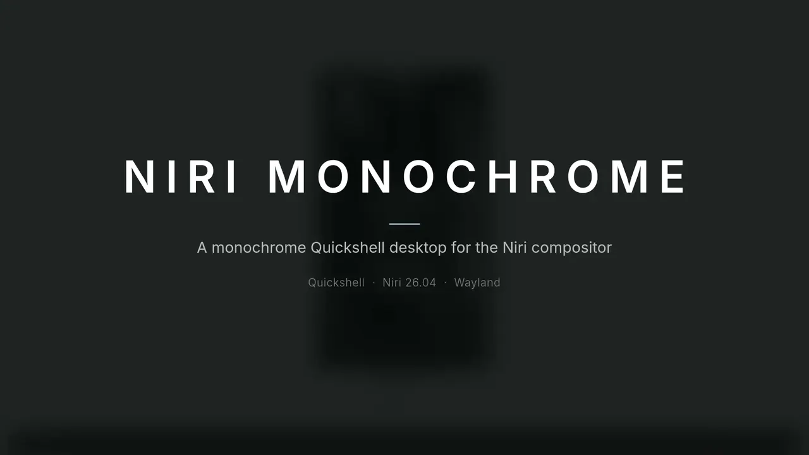

# NIRI MONOCHROME

Monochrome Quickshell desktop for Niri. The current release verification and measurements are in [docs/PHASE3-RELEASE.md](docs/PHASE3-RELEASE.md).

Use the project as `~/.config/quickshell/niri-monochrome`, start with `qs -c niri-monochrome`, and preserve your existing Niri config and desktop-service ownership. This repository is a user configuration, not a full system installer. It does not include personal settings, saved state, or wallpaper collections.

Niri configuration files are included as a reference under `examples/niri/`. Review them before applying: startup commands refer to existing user tools such as `idle-manager`, `volume-osd` and `bright-osd`.

## Demo



The full 70-second demo plays above as an animated image; the original video is [docs/media/niri-monochrome-demo.mp4](docs/media/niri-monochrome-demo.mp4) (1080p, download). It shows the bottom bar, wallpaper rotation, dock, launcher, Control Center, notifications, media controls, Settings, keyboard shortcuts, overview, power menu and lock screen. It was recorded in a nested Niri session with a private copy of the configuration, and every panel is opened over IPC (`qs -c niri-monochrome ipc call …`).

## Screenshots

Niri provides the capture backend; existing bindings are preserved:

- `Print`: interactive area selection.
- `Ctrl+Print`: focused screen.
- `Alt+Print`: focused window.

The existing Niri configuration saves to `~/Pictures/Screenshots` and copies captures to the clipboard. Control Center includes Area, Screen and Window buttons, plus **Annotate clipboard** when `swappy` is installed. The overlay closes before capture. Swappy opens the current PNG clipboard image for drawing, text, arrows and saving.

Install the launcher entry with `bash scripts/install-screenshot-entry.sh`. On Fedora the optional annotation editor is installed with `sudo dnf install swappy`; `wl-clipboard` provides `wl-paste`.

Terminal commands:

```sh
qs -c niri-monochrome ipc call screenshot region
qs -c niri-monochrome ipc call screenshot screen
qs -c niri-monochrome ipc call screenshot window
qs -c niri-monochrome ipc call screenshot edit
```

## Validation

```sh
bash tests/niri-ipc-test.sh
bash tests/validate.sh
shellcheck scripts/*.sh tests/*.sh
niri validate
```

Tests isolate configuration/state and the session bus. UI loading requires an existing Wayland backend. Experimental shell locking remains opt-in and needs manual PAM verification; mako remains the notification server.
